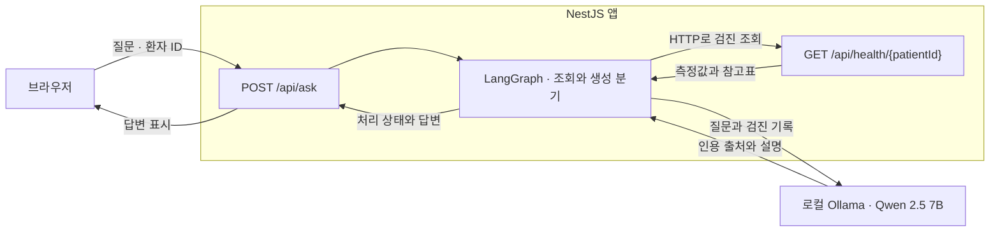

# 사각 Software Engineer (AI Agent) 기술 과제

## 3분 안에 살펴보기

| 과제                  | 핵심 결과                                                                                                                                                                         | 먼저 읽을 곳                                                                                                             |
| --------------------- | --------------------------------------------------------------------------------------------------------------------------------------------------------------------------------- | ------------------------------------------------------------------------------------------------------------------------ |
| 개미수열              | 392,187,941,864자리인 99항에서 가운데 두 문자 `11`을 구했습니다. 1회 측정에서 158.6 ms가 걸렸습니다.                                                                              | [경계를 나눌 수 있는 조건과 성능 비교](algorithm/README.md)                                                              |
| 건강검진 AI Assistant | 검진표의 기준은 서버에서 적용하고 질문에 맞는 기록 선택과 설명은 로컬 모델에 맡겼습니다. 답변 14쌍을 블라인드로 비교해 Qwen 2.5 7B를 선택했습니다(Qwen 9건, Llama 3건, 동률 2건). | [실제 답변 화면](health-assistant/README.md#실행-화면) · [모델 선택과 남은 오류](health-assistant/evaluation/RESULTS.md) |

## 검진 앱에서 질문이 답변이 되기까지

검진 이력이 비어 있으면 그래프는 조회 단계에서 안내 문구를 정하고 종료합니다. [설계 결정 기록(ADR)과 LangGraph 분기](health-assistant/docs/decisions.md)

## 실행 방법

두 과제 모두 Node.js 20.19 이상을 사용합니다. 저장소 루트에서 아래 명령을 실행합니다.

- **개미수열:** `cd algorithm && npm ci && npm test`로 두 풀이를 검증합니다. `npm run benchmark:segment-length-dp -- 99`로 마지막 항의 결과와 실행 비용을 확인합니다.
- **검진 앱:** Ollama를 실행한 뒤 `ollama pull qwen2.5:7b`로 모델을 설치합니다. `cd health-assistant && npm ci && npm start`를 실행하고 [검진 상담 화면](http://127.0.0.1:3000/)을 엽니다.

[과제 원문](https://docs.google.com/document/d/1Yy7j8-3thG95YvcmjM-J84J5_Bycl-3pTTUmZORdOOA/edit?tab=t.0)에서 요청한 알고리즘 소감은 [분할 조건을 찾은 과정](algorithm/README.md#반례에서-분할-조건을-찾았습니다)에, 검진 앱의 구현 계획과 개발·운영 프롬프트는 [AI 사용 기록](health-assistant/ai-usage.md)에 정리했습니다. 커밋 메시지는 `type: 변경 목적` 형식으로 작성합니다.
