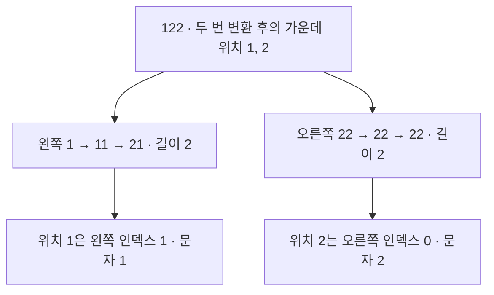

# 개미수열의 가운데 두 자리

## 상황 · 51항에서 전체 생성의 한계가 드러났습니다

개미수열은 연속된 같은 숫자를 묶어 '개수'와 '숫자'를 차례대로 읽어 다음 항을 만드는 수열입니다. 첫 번째 풀이에서는 매번 다음 항의 전체 문자열을 직접 생성했습니다. 이 방식은 알고리즘 구현이 직관적이지만, 51항의 길이가 1,166,642자에 달해 이 구현에 둔 100만 자 생성 제한을 초과했습니다.

## 목표 · 99항에서도 필요한 두 문자만 구합니다

함수 `middle(n)`은 4~99 사이의 정수 n을 입력받아 n번째 항의 가운데 두 문자를 순서대로 반환해야 합니다. 예를 들어 5항 `111221`의 정답은 `12`입니다. 작은 항에서는 전체를 직접 생성한 결과와 대조해 정답을 검증하고, 큰 항에서는 가운데 두 문자의 위치를 찾는 데 필요한 정보만 계산하기로 목표를 세웠습니다.

## 행동 · 서로 독립적으로 변환할 수 있는 구간을 찾았습니다

### 반례에서 분할 조건을 찾았습니다

`211`을 `2 | 11`로 나눠 한 번 변환하면 `12 | 21`입니다. 두 조각을 붙인 `1221`은 전체를 한 번에 변환한 결과와 같습니다. 하지만 이를 한 번 더 변환하면 경계에 맞닿은 두 개의 `2`를 함께 세어야 하므로, 조각별 변환 결과를 단순히 이어 붙일 수 없습니다.

왼쪽 조각의 마지막 숫자는 다음 항으로 변환된 뒤에도 바뀌지 않는다는 특징이 있습니다. 이 성질을 활용해 남은 각 변환 직전에 오른쪽 첫 숫자가 왼쪽 끝 숫자와 계속 다른지 확인했습니다. 남은 변환이 모두 끝날 때까지 서로 합쳐지지 않는 안전한 경계에서만 조각을 나누고, 그러한 경계가 없으면 조각 전체를 한 번 직접 변환했습니다.

### 조각의 길이로 가운데 위치를 찾습니다

예를 들어 `122`를 두 번 변환할 때는 `1`과 `22`로 나누어 독립적으로 계산할 수 있습니다. 두 번 변환한 뒤 두 조각의 최종 길이는 각각 2이므로 전체 길이는 4가 되며, 0부터 셀 때 가운데 인덱스는 1과 2입니다.



동일한 조각과 남은 변환 횟수가 다시 나오면 이미 계산해 둔 길이를 재사용합니다. 실제 문자를 탐색할 때는 목표 위치보다 앞선 조각들을 그 길이만큼 건너뛰며 필요한 위치로 이동합니다. [분할 조건과 복잡도](segment-length-dp/README.md)

## 결과

### 35항은 전체 생성이 빨랐고 99항은 구간 분할로 풀었습니다

Node.js 20.19.4, macOS arm64 환경에서 각 사례마다 새 프로세스를 띄워 1회씩 측정했습니다. 최대 메모리(RSS)에는 Node.js 런타임의 기본 메모리가 포함됩니다.

| 풀이                |   n | 가운데 | 함수 실행 시간 |   최대 RSS |
| ------------------- | --: | ------ | -------------: | ---------: |
| 전체 항 생성        |  35 | `12`   |         2.8 ms | 44,176 KiB |
| 구간 분할과 길이 DP |  35 | `12`   |         8.0 ms | 50,112 KiB |
| 구간 분할과 길이 DP |  99 | `11`   |       158.6 ms | 71,616 KiB |

35항에서는 분할 경계를 확인하는 연산 비용 때문에 전체 항을 직접 생성하는 방식이 더 빨랐습니다. 반면 99항은 392,187,941,864자리여서 이 구현의 생성 한도를 넘습니다. 구간 분할과 길이 DP 풀이에서는 총 9,840개의 길이 상태만 계산했으며, 분할을 검토한 조각도 가장 긴 것이 52자에 불과했습니다.

작은 항을 직접 생성하는 첫 번째 풀이를 남겨 둔 덕분에, 분할 조건을 개선할 때마다 정답 결과를 서로 교차 검증할 수 있었습니다. 개발 과정에서 가장 신경 쓴 부분은 **어떤 조각을 건너뛰어도 최종 정답이 달라지지 않는지** 다양한 반례를 통해 확인하는 일이었습니다.

작은 입력에서는 각 항을 한 번씩 순차적으로 읽는 전체 생성 방식의 비용이 낮습니다. 반면 구간 분할 풀이는 동일한 조각의 길이를 다시 계산할 필요가 없지만, 경계를 검사하는 연산 시간과 계산된 길이를 저장하는 메모리가 추가로 듭니다. [전체 생성의 시간·공간 복잡도](full-generation/README.md) · [구간 분할의 시간·공간 복잡도](segment-length-dp/README.md)

## 실행과 테스트

Node.js 20.19 이상 환경에서 저장소 루트를 기준으로 실행합니다. 런타임 외부 의존성은 없으며 npm 잠금 파일로 개발 도구 버전을 고정했습니다.

```sh
cd algorithm
npm ci
npm test
npm run benchmark:full-generation -- 35
npm run benchmark:segment-length-dp -- 99
```

첫 구현을 진행하기 전에 두 가지 규칙을 테스트로 정의했습니다. 첫째, `121`처럼 떨어져 있는 두 `1`은 독립적으로 세어야 합니다. 둘째, 길이가 6인 `111221`에서는 인덱스 2와 3을 읽어 `12`를 반환해야 합니다. 구간 분할 풀이에는 다음 변환에서 경계 문자가 합쳐지는 반례 케이스를 테스트에 추가했습니다. 두 테스트 모음은 외부 서버나 시스템 시계에 의존하지 않고 독립적으로 실행되며, 환경에 따라 달라지는 실행 시간은 통과 기준으로 사용하지 않습니다.

현재 [전체 항 생성 테스트 16개](full-generation/solution.test.ts)와 [구간 분할과 길이 DP 테스트 23개](segment-length-dp/solution.test.ts)를 통해 정합성을 검증합니다. 구간 분할 DP로 구한 결과는 4~35항 범위에서 별도의 정규표현식 생성기 결과와 대조했습니다. 전체 생성이 어려운 99항의 경우, 서로 다른 접두부 길이로 계산한 전체 길이와 앞·중간·뒤 문자가 일치하는지 비교해 검증했습니다.
