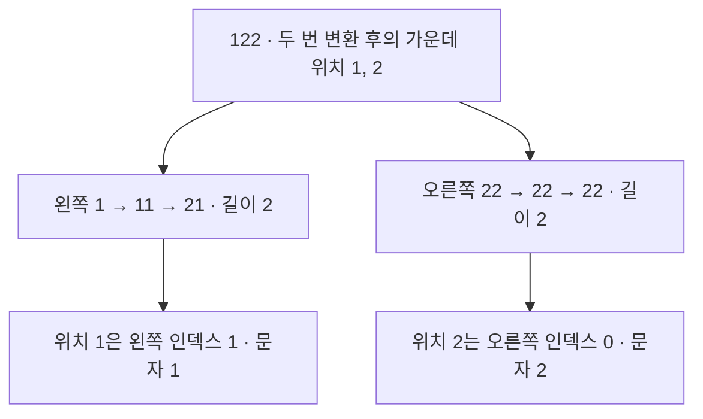

# 개미수열의 가운데 두 자리

`middle(n)`은 정수 4~99를 받아 n번째 항의 가운데 두 문자를 반환합니다. 5항 `111221`의 답은 `12`, 8항 `1113213211`의 답은 `21`입니다. 99항은 392,187,941,864자리지만 필요한 답은 두 문자입니다. 독립적으로 변환할 수 있는 조각의 길이를 계산해 가운데 두 자리 `11`을 구했습니다.

| 풀이                                               | 방법                                                                       | 적용 범위                                                                      |
| -------------------------------------------------- | -------------------------------------------------------------------------- | ------------------------------------------------------------------------------ |
| [전체 항 생성](full-generation/README.md)          | 이웃한 같은 숫자를 묶어 매번 다음 항 전체를 만듭니다.                      | 작은 입력을 대조하는 기준입니다. 51항부터 100만 자 제한을 넘습니다.            |
| [구간 분할과 길이 DP](segment-length-dp/README.md) | 따로 변환해도 되는 조각의 길이를 저장하고 가운데가 속한 조각만 따라갑니다. | 4~99 전체를 처리합니다. 미리 계산한 정답이나 외부 분해 표를 사용하지 않습니다. |

## 조각의 길이로 가운데 위치를 찾습니다

예를 들어 `122`를 두 번 변환할 때는 `1`과 `22`를 따로 읽을 수 있습니다. 두 조각의 최종 길이가 각각 2이므로 전체 길이는 4이고, 가운데 인덱스는 1과 2입니다(0부터 셉니다).



같은 조각과 남은 변환 횟수가 다시 나오면 저장한 길이를 씁니다. 문자를 찾을 때는 목표 위치 앞의 조각을 길이만큼 건너뜁니다. [분할 조건과 복잡도](segment-length-dp/README.md)

## 실행과 테스트

Node.js 20.19 이상에서 저장소 루트 기준으로 실행합니다. 런타임 외부 의존성은 없으며 npm 잠금 파일로 개발 도구 버전을 고정합니다.

```sh
cd algorithm
npm ci
npm test
npm run benchmark:full-generation -- 35
npm run benchmark:segment-length-dp -- 99
```

첫 구현 전에 두 가지를 테스트로 정했습니다. `121`의 두 `1`은 떨어져 있으므로 따로 세고, 길이가 6인 `111221`에서는 인덱스 2와 3을 읽어 `12`를 반환합니다. 구간을 나누는 풀이에는 다음 변환에서 경계가 합쳐지는 경우를 추가했습니다. 두 테스트 모음은 외부 서버나 시계 없이 독립적으로 실행되며 시간 측정값을 통과 기준으로 쓰지 않습니다.

[전체 항 생성 테스트 16개](full-generation/solution.test.ts)와 [구간 분할과 길이 DP 테스트 23개](segment-length-dp/solution.test.ts)를 검사합니다. DP로 구한 결과는 4~35항에서 별도의 정규표현식 생성기와 대조했습니다. 99항은 전체를 독립 생성하기 어려워 서로 다른 접두부 길이로 계산한 전체 길이와 앞·중간·뒤 문자를 비교했습니다.

## 35항은 전체 생성이 빨랐고 99항은 구간 분할로 풀었습니다

Node.js 20.19.4, macOS arm64에서 사례마다 새 프로세스로 한 번 측정했습니다. 최대 메모리(RSS)에는 Node.js 런타임이 포함됩니다.

| 풀이                |   n | 가운데 | 함수 실행 시간 |   최대 RSS |
| ------------------- | --: | ------ | -------------: | ---------: |
| 전체 항 생성        |  35 | `12`   |         2.8 ms | 44,176 KiB |
| 구간 분할과 길이 DP |  35 | `12`   |         8.0 ms | 50,112 KiB |
| 구간 분할과 길이 DP |  99 | `11`   |       158.6 ms | 71,616 KiB |

35항에서는 분할 경계를 확인하는 비용 때문에 전체 항 생성이 더 빨랐습니다. 반면 99항은 392,187,941,864자리입니다. 구간 분할과 길이 DP에서는 길이 상태 9,840개를 계산했고, 분할을 검토한 조각은 가장 긴 것도 52자였습니다.

## 반례에서 분할 조건을 찾았습니다

첫 풀이의 한계는 51항에서 드러났습니다. 가운데 두 문자를 읽기 위해 1,166,642자를 만들면서 이 구현의 100만 자 제한을 넘었습니다. 조각별 길이만 더할 수 있다면 전체 항을 보관할 필요가 없지만, 먼저 조각을 따로 읽어도 같은 수열을 얻는지 확인해야 했습니다.

`211`을 `2 | 11`로 나누면 첫 변환은 `12 | 21`로 맞습니다. 그런데 한 번 더 읽을 때는 경계의 두 `2`를 함께 세야 합니다. 이 반례에서 분할 조건을 찾았습니다. 왼쪽 조각의 마지막 숫자는 변환 뒤에도 그대로이므로, 남은 각 변환 직전에 오른쪽 첫 숫자가 그와 다른지 확인합니다. 확인할 수 있는 경계가 없으면 조각을 통째로 한 번 변환합니다.

작은 입력에서 전체를 만드는 첫 풀이를 남겨 둔 덕분에, 분할 조건을 바꿀 때마다 결과를 직접 대조할 수 있었습니다. 이 문제에서 가장 신경 쓴 부분은 **어떤 조각을 건너뛰어도 답이 달라지지 않는지** 설명하고 반례로 검증하는 일이었습니다.
