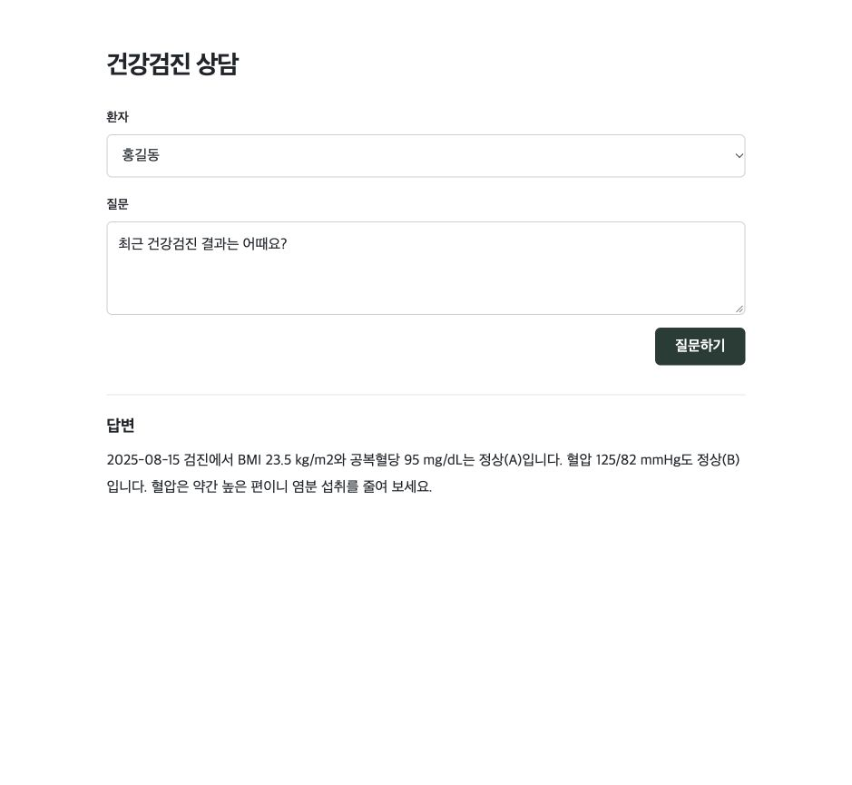
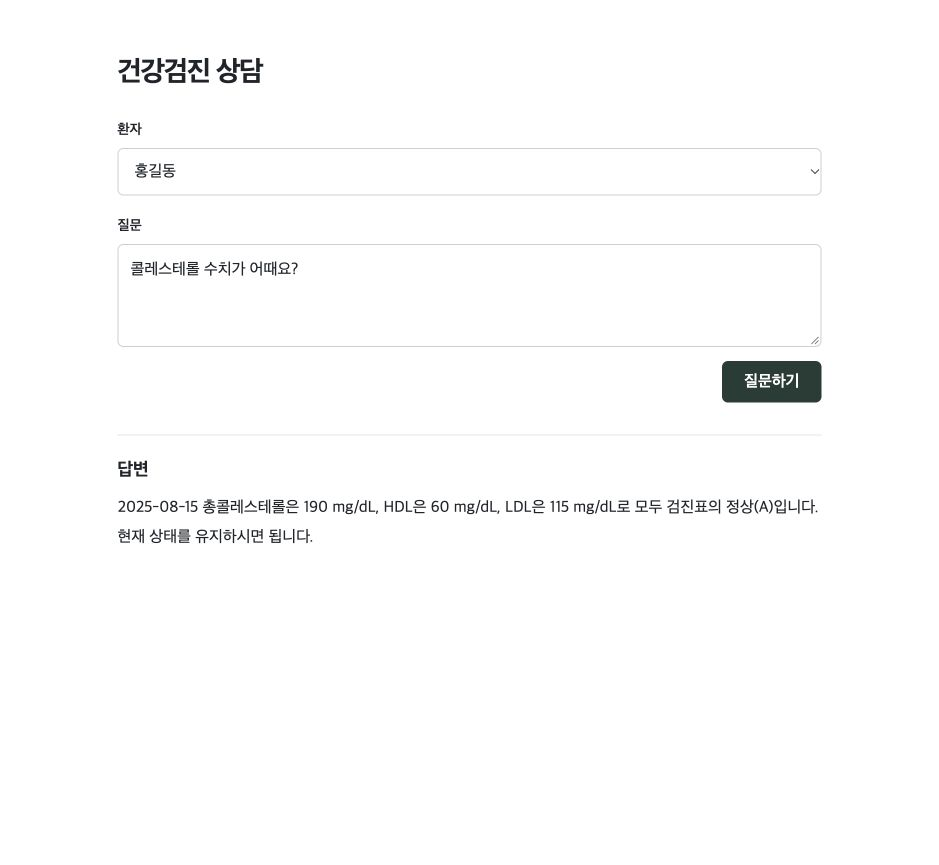

# Health Checkup AI Assistant

서버는 환자의 측정값에 과제 검진표의 기준을 적용합니다. 로컬 모델은 질문에서 시점과 항목을 읽고 해당 기록을 한국어로 설명합니다. 같은 14문항에서 두 모델 모두 기대한 출처를 10번 골랐습니다. 실제 화면 답변을 블라인드로 비교한 결과는 **Qwen 9건, Llama 3건, 동률 2건**이어서 Qwen 2.5 7B를 채택했습니다. [문항별 비교와 프롬프트 변경 결과](evaluation/RESULTS.md)

`lookup`에서 검진 기록을 조회하고 측정값이 있으면 `generate`에서 Ollama를 한 번 호출합니다. 검진 이력이 비었으면 `complete`로 바로 이동해 “검진 기록이 없습니다.”라고 답합니다. [LangGraph 상태 전이도](docs/decisions.md#질문을-처리하는-흐름)

## 설치와 실행

Node.js 20.19 이상과 Ollama가 필요합니다. Ollama 데스크톱 앱을 열거나 별도 터미널에서 `OLLAMA_NO_CLOUD=1 ollama serve`를 실행합니다. 저장소 루트에서 다음 명령으로 앱을 시작합니다.

```sh
ollama pull qwen2.5:7b
cd health-assistant
npm ci
npm start
```

[검진 상담 화면](http://127.0.0.1:3000/)에서 홍길동을 선택하고 “최근 건강검진 결과는 어때요?”라고 묻습니다. 모델을 내려받은 뒤에는 로컬에서 질의와 응답을 처리합니다.

## 실행 화면

**“최근 건강검진 결과는 어때요?”** 홍길동의 2025-08-15 검진에서 BMI·공복혈당·혈압을 함께 설명합니다.



**“콜레스테롤 수치가 어때요?”** 같은 검진에서 총콜레스테롤·HDL·LDL을 골라 답합니다.



두 화면은 기본 모델로 실행한 결과입니다. [질문·응답과 캡처 기록](evidence/final-screenshots.json)

## API와 데이터

`GET /api/health/{patientId}`는 과제의 [예시 JSON](src/health/sample.json)과 같은 구조로 측정값·단위·참고표·검진 메타데이터를 반환합니다. `POST /api/ask`는 이 API를 HTTP로 조회한 뒤 질문에 답합니다.

```sh
curl http://127.0.0.1:3000/api/health/demo-001
curl http://127.0.0.1:3000/api/ask -H 'Content-Type: application/json' \
  -d '{"patientId":"demo-002","question":"LDL 수치는 어떤가요?"}'
```

| 합성 환자    | 확인할 동작                                                                            |
| ------------ | -------------------------------------------------------------------------------------- |
| `demo-001`   | 두 검진의 공복혈당(105 → 95 mg/dL)을 비교합니다.                                       |
| `demo-002`   | LDL 150 mg/dL처럼 제공된 참고표에 분류 구간이 없는 값을 처리합니다.                    |
| `demo-empty` | 검진 이력이 없어 모델을 호출하지 않습니다. 미등록 환자는 별도로 HTTP 404를 반환합니다. |

응답의 `generated`는 JSON 형식과 인용한 기록의 존재를 확인했다는 뜻입니다. **모델이 올바른 기록을 골라도 검진표와 다른 판정을 설명할 수 있습니다.** [모델 비교와 실제 오류](evaluation/RESULTS.md)에서 그 차이를 확인할 수 있습니다.

## 검증

`health-assistant`에서 `npm test`를 실행하면 실제 HTTP 경로, 참고표 처리, 모델 응답의 형식과 출처, 장애 시 반환하는 메시지를 검사합니다. 자동 테스트는 고정된 모델 응답을 사용합니다. 실제 Ollama를 사용하는 명령은 [평가 방법](evaluation/PROTOCOL.md)에 정리했습니다.

[서버와 모델의 역할](docs/decisions.md) · [AI 활용 계획과 프롬프트](ai-usage.md)
