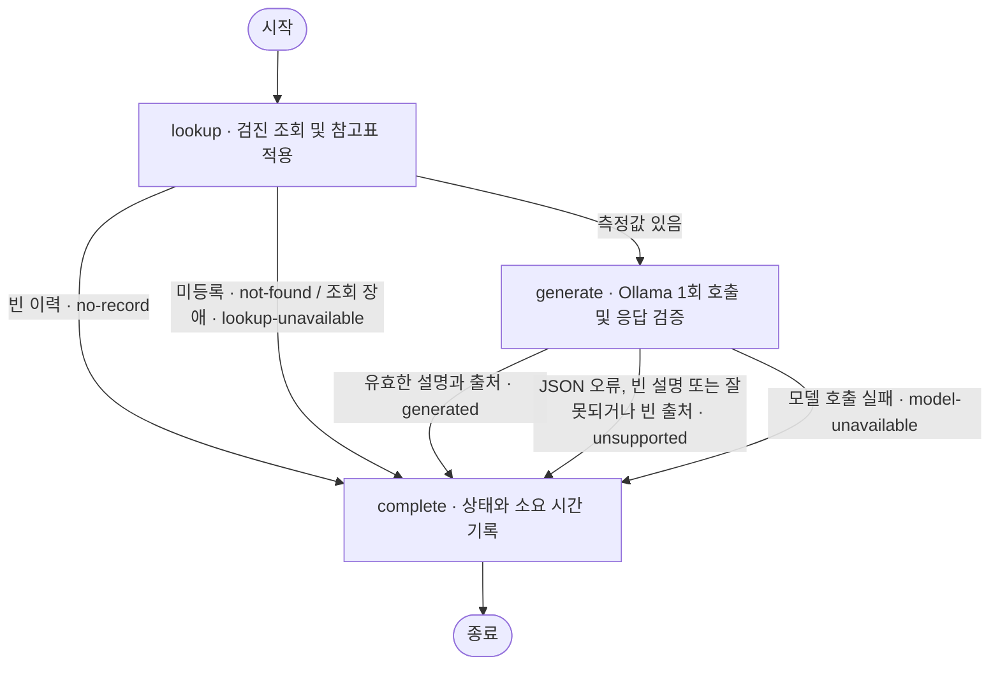

# 검진 기록을 조회하고 질문에 답하는 과정

서버가 검진표의 기준을 각 측정값에 적용합니다. 모델은 질문에 맞는 검사일과 항목을 골라 그 결과를 한국어로 설명합니다.

## 질문을 처리하는 흐름

NestJS는 검진 조회 API와 질문 API를 한 앱에서 제공합니다. 질문 API가 검진 API를 HTTP로 호출하게 해 실제 JSON 응답과 미등록 환자의 404 처리를 통합 테스트로 확인할 수 있습니다. LangGraph를 선택한 이유는 **조회 결과에 따라 모델 호출 여부를 결정하고, 요청이 어느 단계에서 끝났는지 추적하기 위해서**입니다. 각 요청은 독립된 상태를 사용합니다. [질문 API](../src/app.ts) · [그래프 구현](../src/assistant/graph.ts)

- **홍길동이 “콜레스테롤 수치가 어때요?”라고 물으면** `lookup`은 두 검진의 측정값을 준비합니다. `generate`에서 Qwen은 최근 검진인 2025-08-15의 총콜레스테롤·HDL·LDL을 인용하고 각각 190·60·115 mg/dL라고 설명했습니다. 서버는 세 출처가 홍길동의 기록에 있는지 확인합니다. `complete`가 상태와 시간을 기록하면 API는 `generated`와 답변을 반환하고 화면에는 설명이 표시됩니다. [실제 화면](../evidence/answer-cholesterol.jpg)
- **검진 이력이 없는 환자가 “최근 혈압은 어떤가요?”라고 물으면** `lookup`은 등록된 환자를 찾지만 측정값은 비어 있습니다. 이때 상태를 `no-record`로 정하고 `complete`로 바로 이동합니다. 모델 호출은 0회이며 화면에는 “검진 기록이 없습니다.”가 표시됩니다.

## 참고표로 분류할 수 없는 측정값

[참고표 해석 코드](../src/health/evidence.ts)는 측정값마다 검사일·항목·단위와 판정 또는 보류 사유를 연결합니다. 예를 들어 LDL 150 mg/dL는 과제 표에서 정상(B)의 상한 139와 질환의심 하한 160 사이에 있습니다. 혈색소는 성별에 따라 기준이 다르지만 기록에는 성별이 없습니다. 두 경우 모두 수치는 전달하고 판정은 보류합니다.

검사일은 서버가 미리 결정하지 않습니다. 이전 구현에서 “첫 검진의 혈당”을 최근 값인 95 mg/dL로 연결한 적이 있습니다. 현재는 전체 검진을 최신순으로 제공해 모델이 이전 값인 105 mg/dL도 선택할 수 있게 했습니다. 현재 예시 데이터는 두 환자의 검진 3건이어서 한 환자의 전체 기록을 한 번에 전달할 수 있습니다.

기록이 모델의 입력 한도를 넘으면, 질문이 지정한 날짜나 비교 대상 검진을 먼저 조회하고 최근 요약에는 최신 검진만 전달하는 방식을 검토할 계획입니다. 날짜 범위를 줄이기 전에 “첫 검진”과 “두 검진의 차이”에서 필요한 기록이 모두 남는지 평가셋으로 확인해야 합니다.

## 출처 검증으로 보장하는 범위

[모델 어댑터](../src/assistant/model.ts)는 로컬 Ollama의 `/api/generate`에 요청을 보냅니다. 출력은 `sources`와 `explanation` 두 필드입니다. 서버는 JSON이 Zod 스키마에 맞는지, 설명이 비어 있지 않은지, 인용한 검사일과 항목이 모두 해당 환자의 기록에 있는지 확인합니다. 형식이 틀리거나 설명·출처가 비었거나 기록에 없는 항목을 인용하면 “해당 검진을 특정할 수 없습니다.”라고 답합니다.

단어와 숫자를 문자열로 검사했을 때는 같은 값인 `T-score는 -0.8`도 표현이 다르다는 이유로 거절했습니다. 교정 요청에도 같은 누락이 반복되는 사례가 있었습니다. 현재는 한 번 생성한 설명을 그대로 표시하고, 의미 오류는 [실제 응답과 검진표의 대조](../evaluation/RESULTS.md)로 확인합니다. 이 선택은 호출을 줄이지만 설명 속 잘못된 판정까지 막지는 못합니다. [설계 변경의 계기가 된 사례](../evaluation/HISTORY.md)
