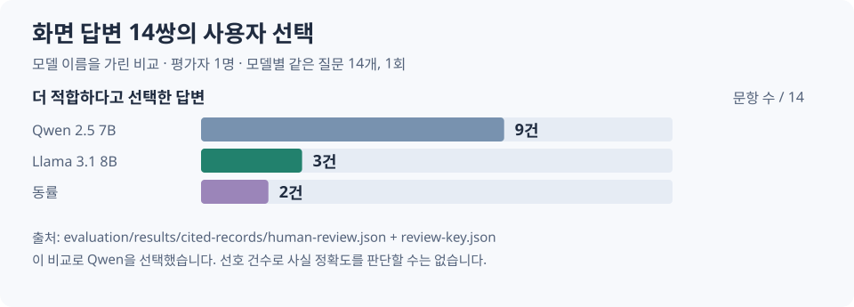

# 실제 화면 답변 14쌍의 블라인드 비교

평가자 한 명이 같은 질문에 대해 모델 이름을 가린 두 화면 답변을 비교했습니다. 이는 JSON 예시 변경 전의 비교입니다.

| 질문 | 선택 | 실제 답변과 검진표 대조 |
| --- | --- | --- |
| 검사일을 지정한 AST·ALT | Qwen | Qwen은 30·28 U/L를 답했고 Llama는 검사 용도와 참고 기준만 설명했습니다. |
| 이전 검진의 혈당 | Llama | Llama는 105 mg/dL를 답했습니다. Qwen도 초안에는 수치를 썼지만 출처가 비어 화면에는 특정 불가 안내가 나왔습니다. |
| HDL·LDL | Qwen | Qwen은 두 수치를 제시했지만 LDL 150 mg/dL까지 질환의심이라고 답했습니다. 과제 표에는 이 값을 분류할 기준이 없습니다. |

선택은 평가자가 남겼고, 표의 수치와 오류는 Codex가 검진표와 대조했습니다. 각 문항의 선호 이유를 추정하지 않았습니다. [14건의 선택과 메모](human-review.json) · [A/B 대응표](review-key.json) · [Qwen 원응답](qwen2.5_7b.jsonl) · [Llama 원응답](llama3.1_8b.jsonl)
