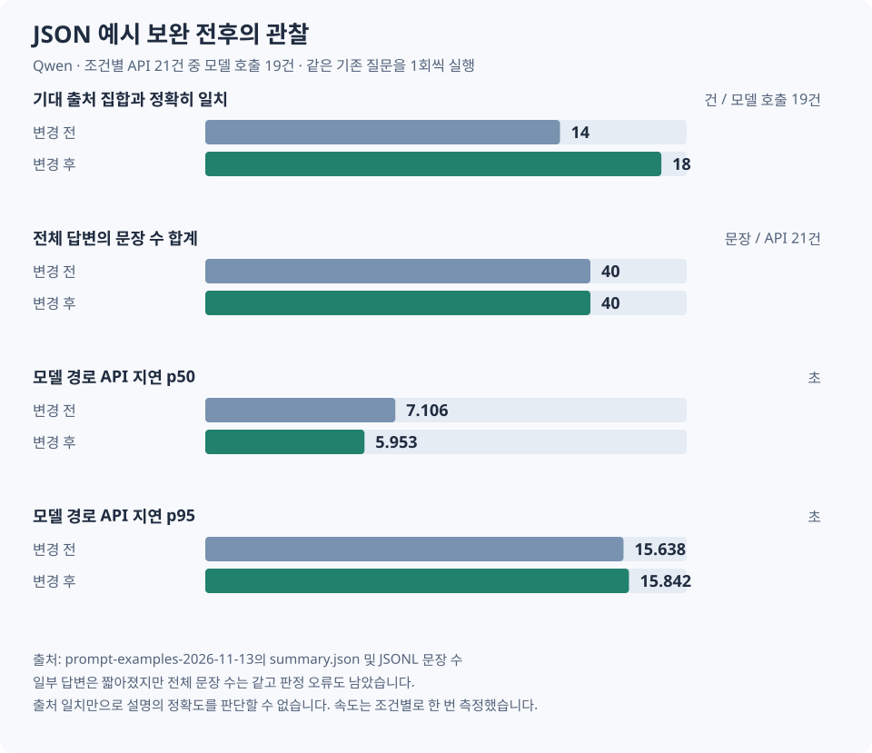

# JSON 예시 변경 전후의 답변 비교

Qwen 2.5 7B에 같은 21문항을 한 번씩 입력했습니다. 두 조건에서 환자 기록, 시스템 지시, 출력 스키마, 생성 설정과 평가기를 고정했습니다. 요약과 콜레스테롤 예문은 실제 응답과 같은 두 필드의 JSON으로 바꾸고, 성별 정보가 없는 혈색소 사례를 추가했습니다. [변경 조건 검증](verification.json)

| 질문 | 변경 전후에 확인한 차이 |
| --- | --- |
| 혈색소 판정 | 근거 없이 정상이라고 답하다가 13.2 g/dL라는 측정값과 성별 정보 부족에 따른 보류 사유를 설명했습니다. 새 예시에 직접 포함된 질문입니다. |
| 크레아티닌 | 비어 있던 출처에 올바른 기록을 넣어 1.2 mg/dL를 답했습니다. 다만 검진표의 ‘1.6 이하’를 ‘1.6 미만’으로 설명했습니다. |
| 두 검진의 혈당 비교 | 기록에 없는 당뇨병 결론이 빠지고 105에서 95 mg/dL로 줄었다고 설명했습니다. |
| HDL·LDL과 간접 혈압 질문 | 표에 없는 ‘질환의심(A)’를 쓰거나 한 답변에서 LDL을 정상과 보류로 함께 설명했습니다. 간접 혈압 질문은 올바른 출처를 고르고도 판정을 틀렸습니다. |

이미 본 질문의 순차 실행 결과이므로 일반적인 정확도나 속도 우위로 해석할 수 없습니다. 다음 원자료에서 각 질문의 입력, 모델 원문과 화면에 표시한 답변을 함께 확인할 수 있습니다.

| 조건 | 21문항의 원문 | 집계 |
| --- | --- | --- |
| 변경 전 | [입력과 응답](before/qwen2.5_7b.jsonl) | [결과](before/summary.json) |
| 변경 후 | [입력과 응답](after/qwen2.5_7b.jsonl) | [결과](after/summary.json) |

[평가 실행 방법](../../PROTOCOL.md) · [변경 전 프롬프트 코드](before/source/src/assistant/model.ts) · [최종 프롬프트](../../../ai-usage.md#최종-운영-프롬프트)
